# 4.2 y 4.3 El schema heredado y el diagrama entidad-relación

> Parte de la skill `arquitectura`, sección 4. Hasta ADR-01 §5 eran `docs/modelo-datos.md` §2 y §3, hoy §4.2 y §4.3, con el mismo prefijo `4.` que el resto del modelo. **El ER de §4.3 se actualiza en el mismo cambio que la `@Entity`** (regla dura 10, procedimiento §7.3).

## 4.2 Qué cambió respecto al schema heredado

El razonamiento de cada fila está en la ADR que cita. Resumen de lo estructural:

| Área | Cambio | Ref. |
|---|---|---|
| Nombres | `Tables` → `game_tables`, `Users_registration` → `table_registrations`, `Users_Rejected` → `registration_rejections`, `Days` → `table_schedules`, `Logs` → `audit_logs` | — |
| Zona horaria | **Se eliminan** `users.timezone` y `game_tables.timezone` | ADR-03 §6 |
| Roles | Son **cuatro**: `Player`, `Master`, `Admin`, `Owner`. Acumulables, sin jerarquía | ADR-06 §1 |
| Rol de mesa | `masters.master_type` pasa de `Owner`/`Master` a **`Primary`/`Secondary`** | ADR-06 §3 |
| Postulaciones | **Se quita** el `UNIQUE (game_table_id, user_id)`: un usuario puede postularse N veces | ADR-09 §1 |
| Contador de jugadores | Se elimina `Players_Table`; se deriva con `COUNT`. Se agrega `max_players` | ADR-03 §1, ADR-07 §5 |
| Sesiones | Tabla nueva `table_sessions`, materializada, con asistencia | ADR-08 §3, §4 |
| Peticiones | Tablas nuevas `table_tasks` + `task_submissions` + `submission_files` | ADR-15 §1 |
| Comentarios | **Se elimina `comments.user_created_id`**. El autor vive solo en `comment_drafts` y desaparece al confirmar. Cuota antispam como token opaco | ADR-11 §5, §6 |
| Catálogos | `parent_id` → **`canonical_id`**, profundidad 1. Son grupos de sinónimos, no jerarquía | ADR-12 §1, §2 |
| Archivos | `file_type` (`Public`/`Library`/`Private`/`Single-use`, ADR-14 §7) y `size_bytes`, que el código usaba y el DDL nunca tuvo. Más `content_hash`, `storage_key`, `last_used_at` y `published_at` (ADR-14 §7) | ADR-13 §1, §2, §3, §6 |
| Aprobaciones | `requests` se absorbe en **`approval_requests`**, un solo mecanismo para todos los pedidos con aprobación. **La tabla ya estaba en `V1__baseline.sql`**: F3.2 le puso el código, no el DDL, así que no hay migración propia y no puede haberla (regla dura 8). Nace con **tres** tipos —`MasterGrant`, `TableOpen`, `General`—, no con los cinco que enumera ADR-16 §1: `TablePause` y `PlayerBan` los agrega F3.4 **con su productor**, porque la columna es `VARCHAR(32)` y sumar un flujo es sumar un valor al enum, sin `ALTER TABLE` (ADR-16 §2). Declararlos antes solo crearía dos valores que nada emite, que es el huérfano que F1.7 le reprochó a `PauseRequested` | ADR-16 §1, §2 |
| Moderación de mesa | Tabla nueva `table_status_changes` con la justificación de cada transición | ADR-07 §2 |
| Moderación de personas | Tablas nuevas `user_role_changes` y `user_status_changes` (`V11`, F3.1), calcadas de `table_status_changes`, con **motivo obligatorio**. `audit_logs` es F6 y `approval_requests` es F3.2: hasta entonces cada entidad guarda su propio rastro en vez de inventar una tabla genérica que F6 va a reemplazar | ADR-05 §7, ADR-06 §1 |
| Configuración | `system_settings` **ya estaba en `V1__baseline.sql`** y no tenía código: F3.5 le puso el mapeo, no el DDL. **Guarda solo overrides** —no hay fila para un ajuste que nadie tocó y no hay seed—, y el catálogo con los valores por defecto, los rangos y la marca de retroactivo vive en el `enum` `SettingKey` (ADR-17 §3). Tabla nueva `system_setting_changes` (`V13`, F3.5), del mismo molde que las de abajo: `setting_key` **sin FK**, porque apunta a una constante del código y porque la fila que nombra puede legítimamente no existir todavía | ADR-17 §3 |
| Moderación de mesa, por persona | Tabla nueva `registration_status_changes` (`V12`, F3.4), del mismo molde: el **veto y su levantamiento**, con motivo obligatorio. Lo que se guarda es el cambio y no el estado — una columna `blocked_reason` no puede contar que se levantó, ni cuántas veces | ADR-09 §4, §5 |
| Feedback del sistema | Tablas nuevas `system_feedback` y `feedback_quotas`. El tipo `General` sale de `comments` | ADR-11 §11, §12 |
| Bandeja de admins | `claimed_by` / `claimed_at` en `approval_requests`, `comments`, `system_feedback` y `game_tables` | ADR-16 §5 |
| PK y tipos rotos | Se corrigen los PK inválidos de `Platforms`/`Tags`/`Systems`, se agregan PK a `registration_rejections` y `audit_logs`, y `Files.mine` pasa a `mime_type VARCHAR(128)` | — |

## 4.3 Diagrama entidad-relación

Vista general, sin columnas — están en el DDL (§4.4, `ddl.md`).

Para verlo por subsistema y con columnas: `docs/diagramas/11` a `16`. Los ciclos de vida (mesa, postulación, comentario) están en `docs/diagramas/05`, `06` y `07`.

```mermaid
erDiagram
    users ||--o{ users_roles : "tiene"
    roles ||--o{ users_roles : "asignado a"
    users ||--o{ user_role_changes : "historial de roles"
    roles ||--o{ user_role_changes : "otorgado o quitado"
    users ||--o{ user_role_changes : "otorga o quita"
    users ||--o{ user_status_changes : "historial de cuenta"
    users ||--o{ user_status_changes : "bloquea o desbloquea"
    users ||--o{ system_settings : "configuró por última vez"
    users ||--o{ system_setting_changes : "cambió un ajuste"

    table_types  ||--o{ game_tables : "clasifica"
    game_tables  ||--o{ masters : "dirigida por"
    users        ||--o{ masters : "dirige"
    game_tables  ||--o{ table_schedules : "agenda semanal"
    game_tables  ||--o{ table_sessions : "sesiones"
    table_sessions ||--o{ session_attendance : "asistencia"
    users        ||--o{ session_attendance : "asiste"
    game_tables  ||--o{ table_status_changes : "historial de estado"
    users        ||--o{ game_tables : "reserva la revisión (ADR-16 §5)"

    game_tables        ||--o{ table_registrations : "postulaciones"
    users              ||--o{ table_registrations : "se postula"
    table_registrations ||--o{ registration_rejections : "rechazos"
    table_registrations ||--o{ registration_status_changes : "historial de veto (ADR-09 §5)"
    users              ||--o{ registration_status_changes : "veta o levanta"
    table_registrations ||--o{ registration_files : "adjuntos"

    game_tables        ||--o{ table_tasks : "pide"
    table_sessions     ||--o{ table_tasks : "atada a (opcional)"
    table_tasks ||--o{ task_submissions : "entregas"
    users              ||--o{ task_submissions : "entrega"
    task_submissions ||--o{ submission_files : "adjunta"

    users ||--o{ files : "subio"
    files ||--o{ table_files : ""
    files ||--o{ registration_files : ""
    files ||--o{ submission_files : ""
    game_tables ||--o{ table_files : "adjunta"

    game_tables ||--o{ table_systems : "usa"
    systems     ||--o{ table_systems : ""
    systems     ||--o{ systems : "canonico de"
    game_tables ||--o{ table_tags : "etiquetada"
    tags        ||--o{ table_tags : ""
    tags        ||--o{ tags : "canonico de"
    game_tables ||--o{ table_platforms : "se juega en"
    platforms   ||--o{ table_platforms : ""
    platforms   ||--o{ platforms : "canonico de"

    users ||--o{ comments : "es comentado"
    users ||--o{ comments : "modera"
    users ||--o{ comment_drafts : "escribe (solo mientras es borrador)"
    users ||--o{ approval_requests : "solicita"
    users ||--o{ approval_requests : "reserva (ADR-16 §5)"
    users ||--o{ approval_requests : "resuelve"
    users ||--o{ notifications : "recibe"
    users ||--o{ audit_logs : "genera"
    %% system_feedback y comment_quotas no tienen relaciones: son anonimos a proposito
```

`comment_quotas`, `feedback_quotas` y `system_feedback` no aparecen: no tienen relación con ninguna tabla, a propósito — son las piezas anónimas del modelo (ADR-11 §5, §11, §12).
